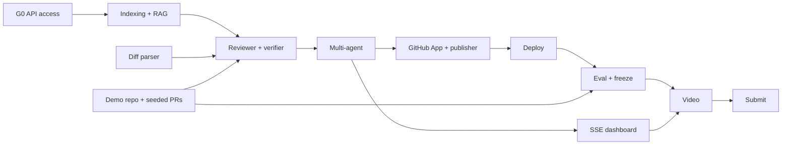

# PLAN.md — Winnow Master Plan

> Updated: 27 Oct 2026, 21:00 MYT · Status: planning, no code yet
> Product name decided 27 Oct: **Winnow** (separates wheat from chaff — the verifier story).

**Core decision:** build Winnow, an autonomous AI workflow assistant that reviews pull requests and keeps
documentation up to date automatically. It runs on Muse Spark 1.3 through the Meta Model API, with a multi-agent
architecture and RAG over the repository. Internal target: submit on **Wednesday 4 Nov 2026, 22:00 MYT**, which is
12 hours before the official deadline (**Thursday 5 Nov 2026, 10:00 MYT**).

---

## 1. One-page summary

| Item | Decision |
| --- | --- |
| What | GitHub App + CLI + dashboard that reviews PRs and drafts documentation updates |
| For whom | Solo developers and small teams (2–10 people) without a dedicated reviewer; open-source maintainers |
| Problem | PRs wait hours for review; reviews are shallow because the reviewer lacks repo context; docs fall behind the code |
| Hero demo moment | Open a PR → within about a minute, inline comments appear that cite **other files** the PR never touched, with a "Commit suggestion" button, plus docstring and README patches |
| Core tech | Python 3.12, FastAPI, Muse Spark 1.3 (Responses API), tree-sitter, SQLite FTS5, ChromaDB |
| Track | Indie developer (assumption, confirm in [open questions](#13-open-questions)) |
| Working window | 8 days: Tuesday 27 Oct evening → Wednesday 4 Nov |
| API budget | $150 Meta Model API credits; planned spend ≤ $80 |

## 2. Hackathon facts that shape this plan

| Fact | Value | Effect on the plan | Source |
| --- | --- | --- | --- |
| Submission deadline | 4 Nov, 9:00 PM ET (EST, UTC−5) = **5 Nov, 10:00 MYT** | Submit 4 Nov 22:00 MYT; 12-hour buffer | [Meta](https://dev.meta.ai/events/global-hackathon), [Cerebral Valley](https://cerebralvalley.ai/e/meta-ai-developer-hackathon) |
| Workshops and office hours | 27 Oct – 4 Nov, on Discord | Attend Model API and Muse Code sessions; raise access questions early | Meta |
| Judging | 4–8 Nov; finals 9 Nov ET | The demo must work without us after submission (hosting stays up until 10 Nov) | Meta |
| Indie track criteria | Creativity, technical ambition, and whether it works | Prioritise demo stability and one standout technical idea | Meta |
| Startup track criteria | Technical execution and whether it holds up in production | If Startup: hosting, limits, errors, metrics matter more | Meta |
| Judging weights (third party, unverified) | Impact 30%, Use of Meta AI Tooling 25%, Demo 25%, Technical Depth 20% | Feature-to-criteria map in §4 | [AImagazine](https://aimagazine.blog/meta-opens-its-1m-global-ai-developer-hackathon-20000-seats-150-api-credits-each-and-applications-close-october-25/) |
| Meta tools | Model API (Muse Spark, Muse Image, SAM 3.1), open weights, Muse Code | Muse Spark for all inference; Muse Code to build the demo repo | Meta, [docs](https://dev.meta.ai/docs) |
| Credits | $150 Meta Model API per participant (third party) | Budget in §10 | AImagazine |
| Indie team size | Up to 4 people (third party) | This plan assumes solo | AImagazine |
| Official Rules | Published before 26 Oct; not yet read | F0 task: read the sections on existing code, video, repo | Meta |

### Meta Model API facts used in the design

| Fact | Value | Source |
| --- | --- | --- |
| Base URL / auth | `https://api.meta.ai/v1`, bearer `MODEL_API_KEY` | [docs](https://dev.meta.ai/docs), [quickstart](https://dev.meta.ai/docs/quickstart) |
| Models | `muse-spark-1.3` (latest, aimed at coding and agentic work); `muse-spark-1.3-contributor` | docs, [promptfoo](https://www.promptfoo.dev/docs/providers/meta/) |
| Context | 1,048,576 tokens | docs |
| Protocols | Responses, Chat Completions, Messages (Anthropic-compatible); the OpenAI SDK works | docs |
| Features | Parallel tool calling, structured output, reasoning effort, prompt caching, search grounding, image/video/PDF input | docs |
| Reasoning effort | `minimal`, `low`, `medium`, `high`, `xhigh` | promptfoo |
| Standard pricing (per 1M tokens) | Input $1.25 · cached $0.15 · output $4.25 | promptfoo |
| Contributor pricing | Input $0.10 · output $0.20, **but Meta may use prompts for training** | promptfoo |
| Rate limits | Standard 3,000 RPM / 4M TPM; contributor 100 RPM / 3M TPM (per team) | promptfoo |
| Embeddings | **No embeddings endpoint** in the docs | docs |
| Web search | $2.50 per 1,000 searches | promptfoo |

Key implications: embeddings must come from a local model (see [ADR-004](docs/DECISIONS.md)), and contributor models
are forbidden for user code (see [SECURITY.md](SECURITY.md)).

## 3. Product vision and success metrics

**One sentence:** every PR gets a review that understands the whole repository, plus updated documentation, within
a minute, without anyone asking.

| Metric | Hackathon target | How it is measured |
| --- | --- | --- |
| Seeded-bug recall | ≥ 70% of bugs planted across the 5 demo PRs | `eval/run_eval.py` ([TESTING.md](docs/TESTING.md)) |
| Comment precision | ≥ 80% of posted comments are valid | Manual labels over eval output |
| False positives | ≤ 1 invalid comment per PR | Eval; PR5 (clean refactor) must stay nearly silent |
| Latency | First comment ≤ 90 s for a diff ≤ 500 lines (p50) | `runs.started_at` → `findings.posted_at` |
| Cost | ≤ $0.30 per PR | Cost meter from API `usage` |
| Line-anchor accuracy | 100% of comments on lines that exist in the diff | Deterministic check in the verifier |
| Install time | ≤ 5 minutes from "Install" to first review | Demo recording |

These are starting targets. They are tuned after the first eval in F6.

## 4. Feature-to-criteria map

| Criterion | What we show | Features |
| --- | --- | --- |
| Impact (30%) | A real small-team problem; review time from hours to minutes; docs that stop rotting | Autonomous review, docs agent, eval metrics |
| Use of Meta AI Tooling (25%) | Deep use of Muse Spark, not a single chat call | Per-agent reasoning effort, structured output, parallel tool calling, prompt caching, 1M context, search grounding, Muse Code to build the demo repo |
| Demo (25%) | One clear, live, striking flow | PR → live dashboard → cross-file comment → commit suggestion → docs patch |
| Technical Depth (20%) | Measurable engineering | Hybrid RAG + symbol graph, verifier, baseline-vs-full ablation, prompt-injection defences |

## 5. Design principles

1. **Demo first.** Every phase ends with something that can be shown. A feature that does not appear in the demo
   is P1 or lower.
2. **Evidence or silence.** Every comment must point at a line in the diff and at evidence from the repo. Without
   evidence, the verifier drops it.
3. **Safe by default.** Suggestions only; no auto-merge, no approvals, never execute PR code.
4. **Muse-native.** Use Muse Spark's real features (structured output, tool calling, caching), not a generic chat
   wrapper.
5. **Small, reliable core.** One process, SQLite, no broker. Scale after the hackathon.

## 6. Scope (MoSCoW)

| Priority | Feature | Application promise |
| --- | --- | --- |
| **P0 Must** | Repo indexing: walker, AST chunking (Python, TS/JS), FTS5, embeddings, symbol graph | C7 RAG |
| P0 | Multi-agent PR review: planner, 4 specialists, verifier | C5, C6 |
| P0 | Docs agent: docstrings as inline suggestions; README and CHANGELOG patches in the summary | C4 |
| P0 | GitHub App: webhook, HMAC, installation tokens, inline review + suggestions + summary + check run | C1, C3 |
| P0 | Real-time dashboard: agent trace over SSE, tokens, cost | C8 |
| P0 | Core security controls: secret redaction, output sanitising, size limits, spend limits | — |
| **P1 Should** | PR commands: `/winnow review`, `/winnow docs`, `/winnow ask` | C8 |
| P1 | CLI `winnow review` for local checks before pushing | C8 |
| P1 | Eval harness + ablation report (baseline vs full) | — |
| P1 | Search grounding for dependency CVEs (public repos only) | C2 |
| P1 | `/winnow docs apply`: commit the docs patch to the PR branch (same repo, not forks) | C4 |
| P1 | 👍/👎 reactions on comments stored for tuning | — |
| **P2 Could** | "Hand off to Muse Code" command on each finding (CLI syntax to be verified) | C2 |
| P2 | Muse Glimmer open weights for cheap tasks (chunk summaries) | C2 |
| P2 | More languages (Go, Java) via tree-sitter | — |
| P2 | Run the repo's tests in a sandbox to validate suggestions | — |
| **Won't** | Auto-merge, approving PRs, GitLab/Bitbucket, IDE extension, fine-tuning, paid multi-tenancy | — |

Promise IDs C1–C8 are defined in [REQUIREMENTS.md §1](docs/REQUIREMENTS.md).

## 7. Phases, schedule and gates

Assumption: about 8–10 focused hours a day, solo. All times are MYT (UTC+8).

```mermaid
gantt
    title Winnow — hackathon schedule (MYT)
    dateFormat YYYY-MM-DD
    axisFormat %a %d
    section Foundation
    F0 Setup & access gate            :f0, 2026-10-27, 1d
    F1 RAG core                       :f1, 2026-10-28, 1d
    section Agents
    F2 Single reviewer + diff         :f2, 2026-10-29, 1d
    F3 Multi-agent + docs             :f3, 2026-10-30, 1d
    section Product
    F4 GitHub App integration         :f4, 2026-10-31, 1d
    F5 Dashboard + deploy             :f5, 2026-11-01, 1d
    section Quality
    F6 Eval + security + FREEZE       :crit, f6, 2026-11-02, 1d
    F7 Polish + record demo           :f7, 2026-11-03, 1d
    F8 Submit (22:00 MYT)             :crit, f8, 2026-11-04, 1d
    Buffer until 10:00                :milestone, 2026-11-05, 0d
```

| Phase | Day | Output | Gate (pass criteria) |
| --- | --- | --- | --- |
| F0 | Tue 27 Oct (evening) | API access confirmed, repo and dev GitHub App ready | **G0:** a `muse-spark-1.3` call from Malaysia succeeds with a JSON schema and a tool call, billed to hackathon credits |
| F1 | Wed 28 Oct | `winnow index`, `winnow ask` | **G1:** 5/5 test questions about the demo repo answered with correct file citations |
| F2 | Thu 29 Oct | `winnow review` with one reviewer + verifier v1 | **G2:** ≥ 3 of the 5 seeded bugs in PR1–PR2 found, all line anchors valid — PASSED 28 Oct: 3/5 (B4 float-money, S1 SQL injection, S3 missing auth; all anchors verifier-checked). B1 cross-file citation unconfirmed, S2 hardcoded secret missed → targets for F3/F6 |
| F3 | Fri 30 Oct | Planner, 4 parallel specialists, verifier v2, docs agent, trace + cost | **G3:** full end-to-end run; docs patch passes `git apply --check` — PASSED 28 Oct: full DAG live (plan→context→parallel specialists→docs→verifier, $0.05–0.19/run); PR1 docs inline 47-53 + README patch applies + changelog; PR2 kept=5 zero drops (S1/S2/S3); runs+agent_steps+spend persisted |
| F4 | Sat 31 Oct | Webhook → automatic review on GitHub | **G4:** a real PR on the demo repo receives inline comments and a summary with no manual step — PASSED 28 Oct: PR #6 got inline [High] bug + summary + neutral check, run $0.084. Note: App UI has no event subscription (events:[]); demo uses a repo webhook (documented fallback). |
| F5 | Sun 1 Nov | SSE dashboard, deploy to Fly.io | **G5:** public URL receives webhooks; dashboard shows a run live |
| F6 | Mon 2 Nov | Eval report, security hardening, **feature freeze 20:00** | **G6:** all P0 done; injection tests pass; `eval/report.md` generated; tag `v0.9.0` — PASSED 28 Oct (report+chart generated; INJ suite green; P0 complete; freeze declared, tag blocked: no git per owner) |
| F7 | Tue 3 Nov | Final README, 3 demo rehearsals, rough recording | **G7:** rough video ≤ 3 minutes; README complete |
| F8 | Wed 4 Nov | Final video, write-up, submission | **G8:** submitted before 22:00 MYT; confirmation screenshot saved |

Gate rule: if a gate fails at the end of its day, apply the [cut list](#9-cut-list) before starting the next phase.
Never carry more than one day of debt.

## 8. Detailed tasks

### F0 — Tuesday 27 Oct (evening): setup and access gate

- [ ] Read the Official Rules on the Cerebral Valley portal: video length, public repo, existing code, team size. Update §2.
- [ ] Join Discord; add the Model API and Muse Code workshop times to the calendar (converted to MYT).
- [x] Generate `MODEL_API_KEY`; confirm the $150 credit in the Model API dashboard. (27 Oct: key set, smoke passed)
- [x] Smoke test `scripts/smoke_muse.py`: plain text, JSON schema, one tool call, `reasoning.effort`, two consecutive calls to observe `cached_tokens`. (27 Oct: SMOKE PASS; cache unproven, see DECISIONS.md)
- [x] Try `POST /v1/embeddings`; expect 404. Record the result in [DECISIONS.md](docs/DECISIONS.md). (27 Oct: 404 confirmed)
- [ ] `git init` a fresh repo in this folder. The folder currently sits inside the home-directory git repo (`/Users/adam`); the project repo must stand alone. (Blocked: owner forbade touching git for now)
- [x] `uv init`, folder layout ([ARCHITECTURE.md §6](docs/ARCHITECTURE.md)), ruff, pytest, pre-commit, `.gitignore`, MIT LICENSE. (27 Oct: done; 26 tests green)
- [x] Register the `winnow-dev` GitHub App with minimal permissions ([DEPLOYMENT.md](docs/DEPLOYMENT.md)); private key outside the repo. (27 Oct: App ID 5496650, installed on demo repo, key at ~/.config/winnow/dev.pem mode 600)
- [ ] Set up a webhook tunnel (cloudflared or smee.io). (Deferred to F4; smee channel URL already in App webhook config)
- [x] Create an empty public repo `winnow-demo-shop`. (27 Oct: github.com/aredamz/winnow-demo-shop)

### F1 — Wednesday 28 Oct: RAG core

- [x] `indexing/walker.py`: honour `.gitignore`, skip binaries, 200 KB file limit, secret denylist. (8 tests)
- [x] `indexing/chunker.py`: one chunk per function/class/method for Python and TS/JS; fallback 60-line windows with 10-line overlap. (8 tests)
- [x] `indexing/symbols.py`: definitions and references tables (tree-sitter tags). (4 tests)
- [x] `storage`: SQLite schema + FTS5 ([DATA_MODEL.md](docs/DATA_MODEL.md)). (15 tables, cascade + FTS tests)
- [x] 1-hour embedding spike: `jina-embeddings-v2-base-code` vs `all-MiniLM-L6-v2` on 10 queries; choose by hit@5. (28 Oct: tie 1.0/1.0; kept jina primary, MiniLM fallback — see ADR-004)
- [x] `retrieval/hybrid.py`: FTS + vector + graph, fused with RRF. (graph/FTS/pack/retrieve tests)
- [x] Repo map: directory tree + key symbols, ≤ 8k tokens, used as the cached prompt prefix.
- [x] CLI `winnow index <path>` and `winnow ask <path> "<question>"` with `path:line` citations. (G1: 5/5 pass 28 Oct)
- [x] Build the demo repo code (~1,500 lines, a mini FastAPI shop) with help from Muse Code ([DEMO.md](docs/DEMO.md)). (28 Oct: ~700 Python lines, 19 tests green, pushed to aredamz/winnow-demo-shop; expanded only if eval demands more corpus)
- [x] Write the 5 G1 test questions and their reference answers. (`eval/cases/g1_questions.yaml`; 5/5 pass)

### F2 — Thursday 29 Oct: single reviewer and diff

- [x] `github/diff.py`: parse unified diffs (unidiff), map RIGHT-side lines, map hunks to changed symbols.
- [x] `Finding` schema (Pydantic) → JSON schema for structured output ([MULTI_AGENT.md](docs/MULTI_AGENT.md)). (+ VerifiedFinding, ReviewUnit, FindingsResult wrappers)
- [x] Generalist reviewer with retrieval tools; tool loop capped at 6 rounds. (`agents/base.py` + `retrieval/tools.py`: search_code, find_references, get_symbol, read_file)
- [x] Verifier v1: deterministic checks (path and lines inside the diff, suggestion covers the exact range) + LLM evidence check.
- [x] `--baseline` mode (one prompt, no RAG) for the later ablation.
- [x] Create seeded PR1 and PR2 in the demo repo. (aredamz/winnow-demo-shop #1, #2)
- [x] Unit tests: diff parser, line mapping, schemas.

### F3 — Friday 30 Oct: multi-agent orchestration and docs

- [x] Planner: classify the PR, split it into review units, choose specialists, set the token budget.
- [x] Four specialists: correctness, security, performance, maintainability; a dedicated prompt for each. (correctness+security proven live on PR2; perf/maint prompts ready, first live run in F6 eval)
- [x] Parallel execution (`asyncio`, semaphore of 4); per-run token budget. (2 units × 2 roles concurrent, $0.19/PR2)
- [x] Verifier v2: cross-agent de-duplication, severity calibration, confidence threshold. (dedup proven live: duplicate S3 merged)
- [x] Docs agent: drift detection, docstrings as suggestions, README/CHANGELOG patches, `git apply --check`. (PR1: inline 47-53 in-hunk, README patch applies, changelog entry)
- [x] Event bus: write to `agent_steps` + in-memory pub/sub for SSE. (run_id persisted; SSE stream in F5)
- [x] Cost meter from `usage` (input, cached, output). (per-run ledger + spend_daily)
- [x] Create PR3, PR4 (prompt injection), PR5 (clean refactor). (#3, #4 with INJ-01 body + INJ-03 comment, #5)

### F4 — Saturday 31 Oct: GitHub App integration

- [x] `POST /webhooks/github`: verify HMAC SHA-256, de-duplicate `X-GitHub-Delivery`, reply 202 in < 1 s. (8 integration tests)
- [x] App JWT → installation token, cached and refreshed at minute 50. (+ installation-id lookup: repo webhooks omit it)
- [x] Download the repo snapshot at `head_sha` (tarball) for indexing. (safe_extract: no symlinks/abs/.., caps)
- [x] `installation` → initial index; `push` to the default branch → incremental re-index. (runner; live push event received)
- [x] Publisher: review with inline comments and `suggestion` blocks; summary comment; check run `in_progress` → `completed`. (live on PR #6, neutral)
- [x] `issue_comment`: `/winnow review`, `/winnow docs`, `/winnow ask` (P1). (review/docs/help live; ask + docs-apply reply honestly as F5 items)
- [x] Load `.winnow.yml` ([API.md](docs/API.md)). (unknown-field warnings)
- [x] Integration tests with recorded webhook payloads. (HMAC/dedupe/filters/cooldown)

### F5 — Sunday 1 Nov: dashboard and deploy

- [x] `GET /api/runs/{id}/events` (SSE); run page with one lane per agent: status, tokens, latency, cost. (JSON SSE + replay + live poll; allow-list gated; dashboard renders lanes via EventSource)
- [x] Landing page: short description, GitHub App install button, link to the demo repo's latest run.
- [ ] Dockerfile, `fly.toml`, 3 GB volume, secrets; deploy; switch the App webhook URL to production. (Dockerfile+fly.toml ready, image building; deploy needs owner's Fly account — awaiting approval)
- [x] P1: `/winnow docs apply`; 👍/👎 reactions stored. (docs-apply via Git Data API, same-repo only; reactions poller every 5 min → feedback)

### F6 — Monday 2 Nov: eval, security, FEATURE FREEZE 20:00

- [x] Run the eval: 5 PRs × {baseline, full} × 3 repeats; compute recall, precision, false positives, latency, cost. (final frozen-prompt run in progress 28 Oct)
- [x] Generate `eval/report.md` + a PNG chart for the video. (harness writes both; final numbers pending)
- [x] Prompt tuning on failures: at most 2 rounds. (round 1: temp/fallback/scope; round 2: B1 cross-file rule — DONE, budget exhausted)
- [x] Hardening: secret redaction before the LLM and output scanning; markdown sanitising; size limits; command cooldown; daily spend cap. (all live + tested)
- [x] Prompt-injection test suite passes ([TESTING.md §6](docs/TESTING.md)). (INJ-01/02/03 live; rest unit/integration)
- [ ] Delete data on the `installation.deleted` event. (implemented + unit-covered via cascade test; live-deletion never exercised — honest gap)
- [ ] 20:00 MYT: freeze, tag `v0.9.0`. Bug fixes only after this point. (code freeze DECLARED 28 Oct morning post-tuning; tag blocked: no git per owner)

### F7 — Tuesday 3 Nov: polish and demo

- [ ] Final README: GIF, diagram, quick start, eval table.
- [ ] Rehearse the demo three times on fresh PRs; log every glitch.
- [ ] Record the screen at 1080p; record the voiceover from the script ([DEMO.md](docs/DEMO.md)).
- [ ] Draft the write-up ([SUBMISSION.md](docs/SUBMISSION.md)).

### F8 — Wednesday 4 Nov: submission

- [ ] Final video edit ≤ 3 minutes; upload to YouTube (unlisted); check audio and resolution.
- [ ] Fill in the submission form: track, theme, repo link, video, live URL, write-up.
- [ ] **Submit before 22:00 MYT.** Save a confirmation screenshot.
- [ ] Keep hosting and credits alive until 10 Nov (judging and finals).

## 8a. Critical path



The demo repo and seeded PRs are on the critical path. They are built in parallel during F1–F3, not deferred.

## 9. Cut list

If the schedule slips, cut in this order. Each cut saves roughly the time shown.

| Order | Cut | Saves | Replace with |
| --- | --- | --- | --- |
| 1 | All P2 | 1 day | Mention under "What's next" |
| 2 | 👍/👎 reactions | 2 h | — |
| 3 | `/winnow docs apply` | 3 h | Patch in the summary, applied by hand |
| 4 | CLI `winnow review` | 2 h | Demo through GitHub only |
| 5 | Search grounding for CVEs | 2 h | Security reviewer without web search |
| 6 | Specialists 4 → 2 (correctness + security) | 3 h | One combined prompt for performance and maintainability |
| 7 | Full SSE dashboard | 4 h | Live summary inside the GitHub check run |

Never cut: cross-file RAG, the verifier, the basic docs agent, automatic review via webhook. These are promises
made in the application.

## 10. API budget

Estimate for one medium PR (diff ≤ 500 lines):

| Agent | Input tokens | Output tokens (incl. reasoning) |
| --- | --- | --- |
| Planner | 6k | 1k |
| Context agent | 10k | 2k |
| 4 specialists × | 30k | 3k |
| Verifier | 20k | 3k |
| Docs agent | 15k | 2k |
| **Total** | **~171k** | **~20k** |

Cost: 171k × $1.25/1M + 20k × $4.25/1M ≈ **$0.30 without caching**. With half the input cached ($0.15/1M), about
**$0.20**.

| Use | Runs | Estimate |
| --- | --- | --- |
| Development and debugging | ~120 | $35 |
| Eval (5 PRs × 2 modes × 3 repeats) + tuning | ~60 | $20 |
| Demo rehearsals and recording | ~30 | $10 |
| Judging period (judges trying it) | ~50 | $15 |
| **Total** | | **~$80 of $150** |

Controls: a $20 daily spend cap in config; a log warning at 80%. Contributor models (cheaper) are used only for
evals on the public demo repo, never for user code.

## 11. Daily rhythm

| Time (MYT) | Activity |
| --- | --- |
| Morning | Check yesterday's gate; pick today's top 3 tasks from §8 |
| Midday | Build; commit small and often |
| Afternoon | Run a short eval over the seeded PRs; note recall and cost |
| Evening | Update gate status in this file; push to GitHub; check Discord for announcements |

## 12. Overall definition of done

- [ ] All P0 features work at the public URL and in the demo repo.
- [ ] Gates G0–G8 passed, or the cut list applied and recorded.
- [ ] `eval/report.md` shows baseline vs full with real numbers.
- [ ] The security checklist in [SECURITY.md §8](SECURITY.md) is complete.
- [ ] README, video ≤ 3 minutes and write-up submitted.
- [ ] No secrets in git history (`gitleaks detect` clean).

## 13. Open questions

| # | Question | Why it matters | Needed by |
| --- | --- | --- | --- |
| Q1 | Indie or Startup track? | Different judging criteria | F0 — decided 27 Oct: **Indie** |
| Q2 | Which theme did the application pick: "Build for Your World" or "Push the Frontier"? | Demo narrative | F0 — decided 27 Oct: **Build for Your World** |
| Q3 | Does the API key work from Malaysia? The July preview was US-only | Gate G0; no project without it | F0, tonight |
| Q4 | Official Rules: video length, public repo, is existing code allowed? | Submission format | F0 |
| Q5 | Solo or a team (Indie allows up to 4)? | Task split and schedule | F0 |
| Q6 | How many hours a day are really available? | The plan assumes 8–10 | F0 |
| Q7 | Final product name? | README, GitHub App, video | Decided 27 Oct: **Winnow** |
| Q8 | Hosting: Fly.io or Modal (partner credit $100)? | F5 deploy | F4 |

## 14. Document index

| Document | Contents |
| --- | --- |
| [README.md](README.md) | Public face of the project |
| [SECURITY.md](SECURITY.md) | Threat model, controls, data handling |
| [docs/REQUIREMENTS.md](docs/REQUIREMENTS.md) | Functional and non-functional requirements |
| [docs/ARCHITECTURE.md](docs/ARCHITECTURE.md) | Components, data flow, tech stack |
| [docs/MULTI_AGENT.md](docs/MULTI_AGENT.md) | Agents, contracts, prompts, orchestration |
| [docs/RAG.md](docs/RAG.md) | Indexing and retrieval |
| [docs/DATA_MODEL.md](docs/DATA_MODEL.md) | Database schema |
| [docs/API.md](docs/API.md) | HTTP API, webhooks, CLI, PR commands, config file |
| [docs/TESTING.md](docs/TESTING.md) | Test strategy and eval |
| [docs/DEPLOYMENT.md](docs/DEPLOYMENT.md) | GitHub App, environments, runbook |
| [docs/DEMO.md](docs/DEMO.md) | Demo repo, seeded PRs, video script |
| [docs/SUBMISSION.md](docs/SUBMISSION.md) | Checklist and write-up draft |
| [docs/RISKS.md](docs/RISKS.md) | Risk register |
| [docs/DECISIONS.md](docs/DECISIONS.md) | Architecture decision records |
| [docs/CONVENTIONS.md](docs/CONVENTIONS.md) | Code, commit and prompt conventions |

## 15. Sources

- [Meta Global AI Developer Hackathon — dev.meta.ai](https://dev.meta.ai/events/global-hackathon)
- [Meta Global AI Developer Hackathon — Cerebral Valley](https://cerebralvalley.ai/e/meta-ai-developer-hackathon)
- [Meta Model API docs](https://dev.meta.ai/docs) and [Quickstart](https://dev.meta.ai/docs/quickstart)
- [Promptfoo: Meta Model API provider](https://www.promptfoo.dev/docs/providers/meta/) (pricing, rate limits, parameters)
- [AImagazine: $150 credits, judging weights, team size](https://aimagazine.blog/meta-opens-its-1m-global-ai-developer-hackathon-20000-seats-150-api-credits-each-and-applications-close-october-25/) (third party, unverified)

All facts above were checked on 27 Oct 2026. The Official Rules override any third-party source.
