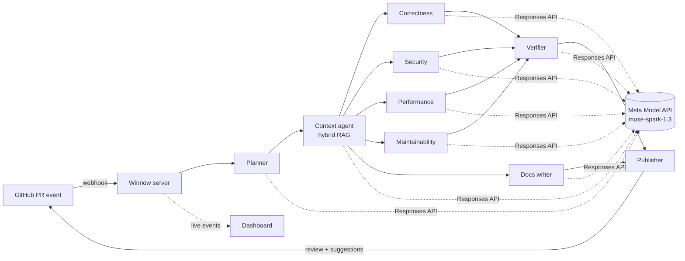

# Winnow

**An autonomous review-and-docs crew for your repository, powered by Meta's Muse Spark.**

Winnow watches your pull requests. When one opens, a team of AI agents reads the diff, pulls in the rest of the
repository through retrieval, reviews the change from several angles, checks its own findings, and posts inline
comments with one-click fixes. When code changes, it also proposes the matching docstring, README and CHANGELOG
updates, so documentation stops drifting from the code.

> Status: planning. Built for the Meta Global AI Developer Hackathon (Oct 26 – Nov 4, 2026). No code yet.

---

## What it does

| Capability | What you see |
| --- | --- |
| Autonomous PR review | Open a PR and inline review comments appear without anyone asking. |
| Repository-aware (RAG) | Comments cite other files, e.g. "this signature change breaks the caller in `billing/invoice.py:42`". |
| Multi-agent | A planner, four specialist reviewers, a verifier and a docs writer, each with its own job and budget. |
| Self-checking | A verifier drops findings that it cannot back with evidence, so the PR is not buried in noise. |
| Docs that keep up | Changed public APIs get docstring, README and CHANGELOG patches proposed in the same PR. |
| Real time | A live dashboard streams every agent step, token and cent as the review runs. |
| Ask the repo | `/winnow ask how is a refund calculated?` answers in the PR thread with file and line citations. |

## How it works



## Built with Meta AI

- **Muse Spark 1.3** via the **Meta Model API** for every reasoning step.
- **Reasoning effort per agent**: low for planning, high for verification.
- **Structured outputs** so every finding is a validated JSON object, never free text.
- **Parallel tool calling** for agentic retrieval across the codebase.
- **Prompt caching** (24 h retention) on the shared repository map to cut cost.
- **1M-token context** so whole files, not fragments, reach the reviewers.
- **Search grounding** (public repos only) for dependency and CVE lookups.

## Documentation

| File | Contents |
| --- | --- |
| [PLAN.md](PLAN.md) | Master plan: scope, phases, daily schedule, gates, budget |
| [SECURITY.md](SECURITY.md) | Threat model, controls, data handling, reporting |
| [docs/REQUIREMENTS.md](docs/REQUIREMENTS.md) | User stories, functional and non-functional requirements |
| [docs/ARCHITECTURE.md](docs/ARCHITECTURE.md) | Components, data flow, tech stack, folder layout |
| [docs/MULTI_AGENT.md](docs/MULTI_AGENT.md) | Agent roster, contracts, prompts, orchestration |
| [docs/RAG.md](docs/RAG.md) | Indexing, chunking, hybrid retrieval, context packing |
| [docs/DATA_MODEL.md](docs/DATA_MODEL.md) | Database schema and vector store layout |
| [docs/API.md](docs/API.md) | HTTP API, webhooks, CLI, PR commands, config file |
| [docs/TESTING.md](docs/TESTING.md) | Test strategy and the evaluation benchmark |
| [docs/DEPLOYMENT.md](docs/DEPLOYMENT.md) | GitHub App setup, environments, runbook |
| [docs/DEMO.md](docs/DEMO.md) | Demo repository, seeded PRs, video script |
| [docs/SUBMISSION.md](docs/SUBMISSION.md) | Submission checklist and write-up draft |
| [docs/RISKS.md](docs/RISKS.md) | Risk register and fallbacks |
| [docs/DECISIONS.md](docs/DECISIONS.md) | Architecture decision records |
| [docs/CONVENTIONS.md](docs/CONVENTIONS.md) | Code, commit and prompt conventions |

## Quick start (target, once built)

```bash
uv sync
cp .env.example .env            # MODEL_API_KEY, GitHub App credentials
uv run winnow index ./some-repo
uv run winnow review ./some-repo --base main
uv run winnow serve             # webhook server + dashboard on :8000
```

## Measured results (frozen prompts, 28 Oct)

Five seeded PRs × {baseline, full} × 3 repeats ([eval/report.md](eval/report.md)):

| Case | Baseline recall | Full recall | Full cost |
| --- | --- | --- | --- |
| PR1 discount refactor | 0.33 | 0.56 | $0.08 |
| PR2 order search | 1.00 | 1.00 | $0.18 |
| PR3 order listing | 1.00 | 0.67 | $0.20 |
| PR4 shipping threshold | 1.00 | 0.67 | $0.03 |
| PR5 clean rename (silent) | 1.00 | 1.00 | $0.03 |

Overall: full crew 7.3/10 bugs (73%) vs 8/10 (80%) for a single prompt.
The full system's measured edge is qualitative: only it cites cross-file
evidence (B1) and proposes doc updates (D1–D3), stays silent on clean PRs,
and filters bogus claims. See [eval/report.md](eval/report.md) for min-max
ranges per repeat.

## License

MIT.
