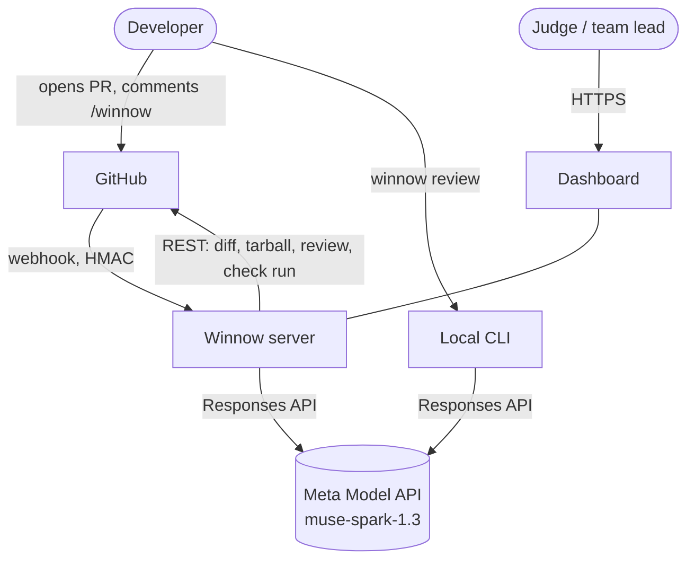
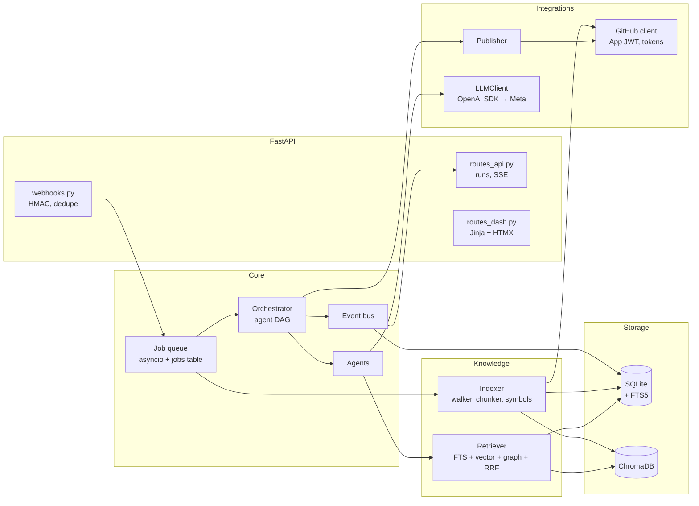
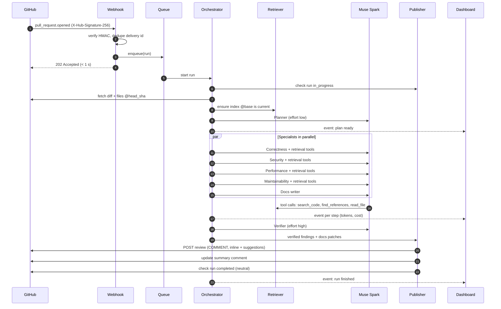
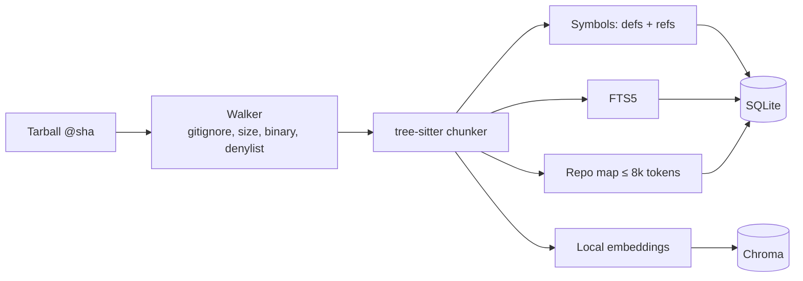

# ARCHITECTURE.md — Winnow Architecture

Winnow is **one Python process** (FastAPI + asyncio workers) with SQLite and ChromaDB on one volume. It receives
GitHub webhooks, indexes repositories, runs an agent graph on Muse Spark, and posts results back to GitHub while
streaming events to a dashboard. The design is deliberately small so the demo stays stable; the scaling path is
in §8.

## 1. System context



Trust boundaries and sensitive data flows are described in [SECURITY.md §2](../SECURITY.md).

## 2. Components



| Component | Responsibility | Main file |
| --- | --- | --- |
| Webhook handler | Verify signature, de-duplicate, filter events, enqueue work, reply 202 | `github/webhooks.py` |
| Job queue | `asyncio.Queue` + `jobs` table for restart durability; 2 workers | `orchestrator/queue.py` |
| Orchestrator | Build and run the agent DAG for one run; budget; cancellation when a new push arrives | `orchestrator/graph.py` |
| Agents | Planner, context, 4 specialists, verifier, docs, Q&A | `agents/` |
| Indexer | Walk, chunk, extract symbols, embed, write to stores | `indexing/` |
| Retriever | Hybrid search and retrieval tools for agents | `retrieval/` |
| LLMClient | The only door to the Meta Model API; retries, cost, tracing, redaction | `llm/client.py` |
| Publisher | Deterministic: findings → GitHub review, summary, check run | `github/publisher.py` |
| Event bus | In-memory pub/sub + writes to `agent_steps` | `orchestrator/events.py` |
| Dashboard | Run list, live run page, landing page | `web/` |
| CLI | `index`, `ask`, `review`, `serve`, `eval` | `cli.py` |

## 3. Main flow: PR opened → review posted



Cancellation: if a new `synchronize` arrives for the same PR while a run is in progress, the old run is cancelled at
the next step boundary and a new run starts.

## 4. Indexing flow



Full details in [RAG.md](RAG.md).

## 5. Tech stack

| Layer | Choice | Why | Rejected alternative |
| --- | --- | --- | --- |
| Language | Python 3.12 | Existing skills; AI ecosystem | TypeScript |
| Package manager | uv | Fast; lockfile | pip, poetry |
| Web | FastAPI + uvicorn | Async, native Pydantic | Flask |
| SSE | sse-starlette | Simple; fits FastAPI | WebSocket (more complex) |
| LLM SDK | `openai` Python SDK → `https://api.meta.ai/v1` | Officially supported by Meta; Responses API | LangChain (extra layer over a new provider) |
| Orchestration | Own asyncio orchestrator (~300 lines) | Full control, clear traces, no framework dependency | LangGraph ([ADR-003](DECISIONS.md)) |
| Schemas | Pydantic v2 | JSON schema for structured output | dataclasses |
| Code parsing | tree-sitter + tree-sitter-language-pack | Many languages, prebuilt wheels | `ast` (Python only) |
| Diff | unidiff | Correct hunk and line-number parsing | Hand-written regex |
| Lexical search | SQLite FTS5 | Built in; no extra service | Elasticsearch |
| Vectors | ChromaDB (PersistentClient) | Existing skills | pgvector, Qdrant |
| Embeddings | fastembed: `jina-embeddings-v2-base-code` (fallback `all-MiniLM-L6-v2`) | No Meta embeddings endpoint; local ONNX | Third-party embedding API ([ADR-004](DECISIONS.md)) |
| Database | SQLite (WAL) + SQLAlchemy 2.0 | One file; enough for one node | Postgres |
| HTTP client | httpx + PyJWT | Full control over GitHub App auth | PyGithub, githubkit |
| Secrets detection | detect-secrets + own patterns | Redaction before the LLM | gitleaks (binary) |
| CLI | Typer + Rich | Fast and good-looking | argparse |
| Frontend | Jinja2 + HTMX + SSE extension, plain CSS | No build step | React + Vite |
| Tests | pytest, pytest-asyncio, respx | Standard | — |
| Quality | ruff (lint + format), pyright | Fast | flake8, mypy |
| Deploy | Docker → Fly.io, 1 machine + volume | Persistent volume for SQLite/Chroma | Modal, Railway ([ADR-009](DECISIONS.md)) |

## 6. Folder layout

```text
winnow/
├── pyproject.toml
├── uv.lock
├── Dockerfile
├── fly.toml
├── .env.example
├── src/winnow/
│   ├── config.py                 # Settings (pydantic-settings) from env
│   ├── cli.py                    # Typer: index, ask, review, serve, eval
│   ├── llm/
│   │   ├── client.py             # LLMClient: Responses API, retries, cost, tracing
│   │   ├── pricing.py            # Per-model prices
│   │   └── prompts/              # *.md, one file per agent, versioned
│   ├── indexing/
│   │   ├── walker.py
│   │   ├── chunker.py
│   │   ├── symbols.py
│   │   ├── embed.py
│   │   └── repomap.py
│   ├── retrieval/
│   │   ├── hybrid.py             # FTS + vector + graph
│   │   ├── fusion.py             # RRF
│   │   └── tools.py              # Tool definitions for agents
│   ├── agents/
│   │   ├── base.py               # Agent: run(input) -> output, tool loop
│   │   ├── schemas.py            # ReviewUnit, ContextPack, Finding, DocsPatch ...
│   │   ├── planner.py
│   │   ├── context.py
│   │   ├── reviewers.py          # 4 specialists, differing in prompt and focus
│   │   ├── verifier.py
│   │   ├── docs.py
│   │   └── qa.py
│   ├── orchestrator/
│   │   ├── graph.py
│   │   ├── queue.py
│   │   ├── budget.py
│   │   └── events.py
│   ├── github/
│   │   ├── app_auth.py
│   │   ├── client.py
│   │   ├── webhooks.py
│   │   ├── diff.py
│   │   └── publisher.py
│   ├── security/
│   │   ├── redact.py
│   │   ├── sanitize.py
│   │   └── limits.py
│   ├── storage/
│   │   ├── db.py
│   │   ├── models.py
│   │   └── vectors.py
│   └── web/
│       ├── app.py
│       ├── routes_api.py
│       ├── routes_dash.py
│       ├── templates/
│       └── static/
├── tests/
│   ├── unit/
│   ├── integration/
│   └── fixtures/                 # webhook payloads, diffs, recorded LLM responses
├── eval/
│   ├── cases/                    # seeded-PR metadata + reference answers
│   ├── run_eval.py
│   └── report.md                 # generated
└── scripts/
    └── smoke_muse.py
```

## 7. Configuration

Environment variables (full list in [DEPLOYMENT.md §2](DEPLOYMENT.md)): `MODEL_API_KEY`, `WINNOW_MODEL`,
`GITHUB_APP_ID`, `GITHUB_APP_PRIVATE_KEY_PATH`, `GITHUB_WEBHOOK_SECRET`, `WINNOW_DATA_DIR`,
`WINNOW_DAILY_SPEND_USD`, `WINNOW_PUBLIC_BASE_URL`.

Per-repo configuration lives in `.winnow.yml` (schema in [API.md §5](API.md)).

## 8. Scaling path after the hackathon

| Now | Later | Trigger |
| --- | --- | --- |
| SQLite + FTS5 | Postgres + pg_trgm/tsvector | > 1 node or > 50 active repos |
| Local ChromaDB | pgvector or Qdrant | Same |
| `asyncio.Queue` | Redis + arq, separate workers | > 4 concurrent runs |
| One Fly.io machine | Separate web and workers, autoscaling | Real traffic |
| Local CPU embeddings | GPU embedding service | Repo index > 100k chunks |
