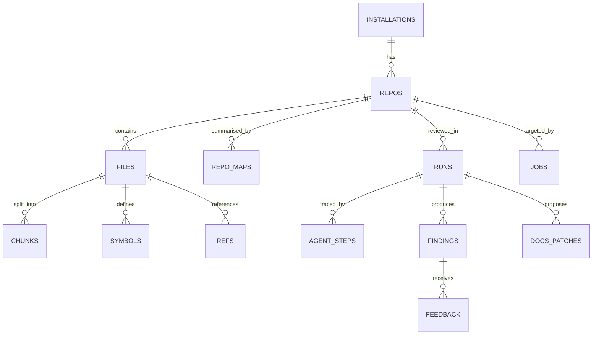

# DATA_MODEL.md — Data Model

All of Winnow's state lives in **one SQLite file** (WAL mode) and **one ChromaDB directory**, both under
`WINNOW_DATA_DIR` on a persistent volume. There is no separate database server.

## 1. Entity diagram



## 2. DDL

```sql
PRAGMA journal_mode = WAL;
PRAGMA foreign_keys = ON;
PRAGMA busy_timeout = 5000;

CREATE TABLE installations (
    id                      INTEGER PRIMARY KEY,
    github_installation_id  INTEGER NOT NULL UNIQUE,
    account_login           TEXT NOT NULL,
    account_type            TEXT NOT NULL CHECK (account_type IN ('User', 'Organization')),
    created_at              TEXT NOT NULL DEFAULT (datetime('now')),
    deleted_at              TEXT
);

CREATE TABLE repos (
    id               INTEGER PRIMARY KEY,
    installation_id  INTEGER NOT NULL REFERENCES installations(id) ON DELETE CASCADE,
    github_repo_id   INTEGER NOT NULL UNIQUE,
    full_name        TEXT NOT NULL,
    private          INTEGER NOT NULL,              -- 0/1; gates web_search and contributor models
    default_branch   TEXT NOT NULL,
    indexed_sha      TEXT,
    index_status     TEXT NOT NULL DEFAULT 'pending'
                     CHECK (index_status IN ('pending', 'indexing', 'ready', 'failed')),
    settings_json    TEXT NOT NULL DEFAULT '{}',   -- parsed .winnow.yml
    public_dashboard INTEGER NOT NULL DEFAULT 0,   -- dashboard allow-list (SECURITY T13)
    created_at       TEXT NOT NULL DEFAULT (datetime('now'))
);

CREATE TABLE files (
    id            INTEGER PRIMARY KEY,
    repo_id       INTEGER NOT NULL REFERENCES repos(id) ON DELETE CASCADE,
    path          TEXT NOT NULL,
    language      TEXT,
    content_hash  TEXT NOT NULL,
    size_bytes    INTEGER NOT NULL,
    indexed_at    TEXT NOT NULL DEFAULT (datetime('now')),
    UNIQUE (repo_id, path)
);

CREATE TABLE chunks (
    id            TEXT PRIMARY KEY,                -- sha1(repo_id + path + symbol + content_hash)
    repo_id       INTEGER NOT NULL REFERENCES repos(id) ON DELETE CASCADE,
    file_id       INTEGER NOT NULL REFERENCES files(id) ON DELETE CASCADE,
    symbol        TEXT,
    kind          TEXT NOT NULL,                   -- function, method, class, module, window, doc_section
    start_line    INTEGER NOT NULL,
    end_line      INTEGER NOT NULL,
    content_hash  TEXT NOT NULL,
    header        TEXT NOT NULL,                   -- contextual header (RAG.md §2)
    text          TEXT NOT NULL,                   -- already redacted
    token_count   INTEGER NOT NULL
);
CREATE INDEX chunks_repo_file ON chunks(repo_id, file_id);

CREATE VIRTUAL TABLE chunks_fts USING fts5(
    chunk_id UNINDEXED,
    path,
    symbol,
    idents,                                         -- split identifiers: apply discount applydiscount
    text,
    tokenize = 'unicode61'
);
-- FTS rows are not covered by foreign keys: the indexer deletes them explicitly
-- whenever it deletes the matching chunks.

CREATE TABLE symbols (
    id        INTEGER PRIMARY KEY,
    repo_id   INTEGER NOT NULL REFERENCES repos(id) ON DELETE CASCADE,
    file_id   INTEGER NOT NULL REFERENCES files(id) ON DELETE CASCADE,
    name      TEXT NOT NULL,                       -- apply_discount
    qualname  TEXT NOT NULL,                       -- Cart.apply_discount
    kind      TEXT NOT NULL,
    line      INTEGER NOT NULL,
    is_public INTEGER NOT NULL                     -- used for docs drift detection
);
CREATE INDEX symbols_name ON symbols(repo_id, name);

CREATE TABLE refs (
    id                 INTEGER PRIMARY KEY,
    repo_id            INTEGER NOT NULL REFERENCES repos(id) ON DELETE CASCADE,
    file_id            INTEGER NOT NULL REFERENCES files(id) ON DELETE CASCADE,
    name               TEXT NOT NULL,
    line               INTEGER NOT NULL,
    enclosing_qualname TEXT
);
CREATE INDEX refs_name ON refs(repo_id, name);

CREATE TABLE repo_maps (
    repo_id      INTEGER NOT NULL REFERENCES repos(id) ON DELETE CASCADE,
    sha          TEXT NOT NULL,
    text         TEXT NOT NULL,
    token_count  INTEGER NOT NULL,
    created_at   TEXT NOT NULL DEFAULT (datetime('now')),
    PRIMARY KEY (repo_id, sha)
);

CREATE TABLE jobs (
    id            INTEGER PRIMARY KEY,
    kind          TEXT NOT NULL CHECK (kind IN ('index', 'review', 'command', 'cleanup', 'poll_reactions')),
    repo_id       INTEGER REFERENCES repos(id) ON DELETE CASCADE,
    dedupe_key    TEXT UNIQUE,                     -- e.g. review:<repo>:<pr>:<head_sha>
    payload_json  TEXT NOT NULL,
    status        TEXT NOT NULL DEFAULT 'queued'
                  CHECK (status IN ('queued', 'running', 'done', 'failed', 'cancelled')),
    attempts      INTEGER NOT NULL DEFAULT 0,
    created_at    TEXT NOT NULL DEFAULT (datetime('now')),
    started_at    TEXT,
    finished_at   TEXT,
    error         TEXT
);

CREATE TABLE webhook_deliveries (
    delivery_id  TEXT PRIMARY KEY,                 -- X-GitHub-Delivery
    event        TEXT NOT NULL,
    received_at  TEXT NOT NULL DEFAULT (datetime('now'))
);

CREATE TABLE runs (
    id                  INTEGER PRIMARY KEY,
    repo_id             INTEGER NOT NULL REFERENCES repos(id) ON DELETE CASCADE,
    pr_number           INTEGER,                   -- NULL for CLI runs
    base_sha            TEXT,
    head_sha            TEXT,
    trigger             TEXT NOT NULL CHECK (trigger IN ('webhook', 'command', 'cli', 'eval')),
    mode                TEXT NOT NULL DEFAULT 'rag' CHECK (mode IN ('rag', 'baseline', 'full')),
    status              TEXT NOT NULL CHECK (status IN ('running', 'done', 'failed', 'cancelled')),
    started_at          TEXT NOT NULL DEFAULT (datetime('now')),
    finished_at         TEXT,
    tokens_in           INTEGER NOT NULL DEFAULT 0,
    tokens_cached       INTEGER NOT NULL DEFAULT 0,
    tokens_out          INTEGER NOT NULL DEFAULT 0,
    cost_usd            REAL NOT NULL DEFAULT 0,
    summary_comment_id  INTEGER,
    check_run_id        INTEGER,
    error               TEXT
);
CREATE INDEX runs_pr ON runs(repo_id, pr_number);

CREATE TABLE agent_steps (
    id              INTEGER PRIMARY KEY,
    run_id          INTEGER NOT NULL REFERENCES runs(id) ON DELETE CASCADE,
    agent           TEXT NOT NULL,
    unit_id         TEXT,
    prompt_version  TEXT NOT NULL,
    model           TEXT NOT NULL,
    effort          TEXT,
    round           INTEGER NOT NULL DEFAULT 0,
    tool_calls_json TEXT,                          -- tool names + argument summaries, no code
    tokens_in       INTEGER NOT NULL DEFAULT 0,
    tokens_cached   INTEGER NOT NULL DEFAULT 0,
    tokens_out      INTEGER NOT NULL DEFAULT 0,
    cost_usd        REAL NOT NULL DEFAULT 0,
    latency_ms      INTEGER,
    status          TEXT NOT NULL CHECK (status IN ('running', 'ok', 'error', 'skipped')),
    error           TEXT,
    started_at      TEXT NOT NULL DEFAULT (datetime('now'))
);

CREATE TABLE findings (
    id                 INTEGER PRIMARY KEY,
    run_id             INTEGER NOT NULL REFERENCES runs(id) ON DELETE CASCADE,
    agent              TEXT NOT NULL,
    path               TEXT NOT NULL,
    start_line         INTEGER NOT NULL,
    end_line           INTEGER NOT NULL,
    severity           TEXT NOT NULL,
    category           TEXT NOT NULL,
    title              TEXT NOT NULL,
    explanation        TEXT NOT NULL,
    evidence_json      TEXT NOT NULL,
    suggestion         TEXT,
    confidence         REAL NOT NULL,
    verdict            TEXT NOT NULL CHECK (verdict IN ('keep', 'drop')),
    verifier_note      TEXT,
    fingerprint        TEXT NOT NULL,              -- sha1(path + category + normalised title + excerpt hash)
    github_comment_id  INTEGER,
    posted_at          TEXT
);
CREATE INDEX findings_fingerprint ON findings(fingerprint);

CREATE TABLE docs_patches (
    id            INTEGER PRIMARY KEY,
    run_id        INTEGER NOT NULL REFERENCES runs(id) ON DELETE CASCADE,
    path          TEXT NOT NULL,
    unified_diff  TEXT NOT NULL,
    reason        TEXT NOT NULL,
    status        TEXT NOT NULL CHECK (status IN ('proposed', 'applied', 'failed'))
);

CREATE TABLE feedback (
    id           INTEGER PRIMARY KEY,
    finding_id   INTEGER NOT NULL REFERENCES findings(id) ON DELETE CASCADE,
    github_user  TEXT NOT NULL,
    reaction     TEXT NOT NULL CHECK (reaction IN ('+1', '-1')),
    observed_at  TEXT NOT NULL DEFAULT (datetime('now')),
    UNIQUE (finding_id, github_user)
);

CREATE TABLE spend_daily (
    day       TEXT PRIMARY KEY,                    -- YYYY-MM-DD in UTC
    cost_usd  REAL NOT NULL DEFAULT 0
);
```

## 3. What the less obvious fields are for

| Field | Purpose |
| --- | --- |
| `jobs.dedupe_key` | A webhook redelivery, or two events for the same `head_sha`, never creates two runs |
| `findings.fingerprint` | FR-16: the same finding isn't re-posted on a later push; 👎 suppression (P1) |
| `runs.mode` | Distinguishes eval runs `baseline`, `rag`, `full` ([RAG.md §8](RAG.md)) |
| `repos.private` | Disables `web_search` and contributor models ([SECURITY.md §3](../SECURITY.md)) |
| `symbols.is_public` | Python: names without a leading `_`; TS/JS: exported. Used by the docs agent |
| `spend_daily` | Daily spend cap; checked before every LLM call |

## 4. ChromaDB

| Item | Value |
| --- | --- |
| Client | `chromadb.PersistentClient(path=WINNOW_DATA_DIR/chroma)` |
| Collections | `repo_{repo_id}`, one per repo (isolation, SECURITY T3 and LLM08) |
| IDs | `chunks.id` |
| Documents | `header + "\n" + text` |
| Metadata | `path`, `symbol`, `kind`, `start_line`, `end_line`, `language` |
| Dimensions | 768 (`jina-embeddings-v2-base-code`) or 384 (`all-MiniLM-L6-v2`) |
| Distance | cosine |

Embeddings are computed by Winnow (fastembed) and passed to Chroma, so the embedding model is controlled in one
place.

## 5. Retention and cleanup

Daily `cleanup` job (02:00 UTC):

- Delete `runs` (and their children via cascade) older than 30 days.
- Delete `webhook_deliveries` older than 7 days.
- Delete finished `jobs` older than 7 days.
- Weekly `VACUUM`.

The `installation.deleted` event deletes the `installations` row (cascading to everything) and drops each repo's
Chroma collection.
