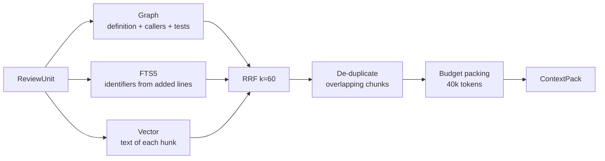

# RAG.md — Indexing and Retrieval

Winnow's retrieval combines **three signals**: the symbol graph (who calls what), FTS5 lexical search (exact
identifiers) and vector search (similar meaning). Results are fused with Reciprocal Rank Fusion and packed into a
token budget. Agents can also search on their own through tools (agentic retrieval).

Why not vectors alone: in code, the most important review question is "who else depends on the function that just
changed?". That is a graph question, not a similarity question.

## 1. File selection

| Rule | Value |
| --- | --- |
| Honour | `.gitignore`, `paths.ignore` in `.winnow.yml` |
| Skip directories | `node_modules/`, `vendor/`, `dist/`, `build/`, `.venv/`, `__pycache__/`, `.git/` |
| Skip files | Binaries (NUL byte in the first 8 KB), `*.lock`, `*.min.js`, average line length > 300 |
| Size limits | 200 KB per file; 20,000 files per repo |
| Secret denylist | `.env*`, `*.pem`, `*.key`, `id_rsa*`, `*.p12`, `credentials*.json`, `*.tfstate` |
| Docs | `README*`, `CHANGELOG*`, `docs/**/*.md` indexed separately for `search_docs` |

## 2. AST chunking

| Language | Nodes that become chunks |
| --- | --- |
| Python | `function_definition`, `class_definition` (signature + docstring + method list), each method |
| TypeScript / JavaScript | `function_declaration`, `class_declaration`, `method_definition`, exported arrow functions |
| Others | 60-line windows, 10-line overlap |
| Markdown | One chunk per `##` or `###` heading |

Size rule: chunks > 1,500 tokens are split at statement-block boundaries, with the header repeated. Top-level
statements (imports, constants) are grouped into one "module chunk" per file.

**Contextual header.** Every chunk gets a prefix before it is embedded and FTS-indexed:

```text
# path: shop/pricing.py | class: Cart | symbol: Cart.apply_discount | lines 18-34
# imports: decimal.Decimal, shop.models.Coupon
```

This is a cheap form of "contextual retrieval": file context is added without any LLM call.

## 3. Chunk metadata

| Field | Example |
| --- | --- |
| `chunk_id` | `sha1(repo_id + path + symbol + content_hash)` |
| `path` | `shop/pricing.py` |
| `language` | `python` |
| `symbol` | `Cart.apply_discount` |
| `kind` | `method` |
| `start_line`, `end_line` | `18`, `34` |
| `content_hash` | sha1 of the content |
| `indexed_sha` | The commit that was indexed |

## 4. Three indexes

### 4.1 Symbol graph

- Definitions: name, qualified name (`Cart.apply_discount`), kind, path, line.
- References: name called or imported, path, line, enclosing symbol.
- Resolution by name + import analysis. No type inference. Limitation: identical names in two modules can mix;
  mitigated by preferring paths that import that module.

### 4.2 FTS5 lexical

- Virtual table `chunks_fts(text, path, symbol, idents)`, tokenizer `unicode61`.
- `idents` holds split identifiers: `applyDiscount` → `apply discount applydiscount`; `apply_discount` →
  `apply discount apply_discount`. This lets search work across naming styles.
- Ranking: `bm25(chunks_fts)`.

### 4.3 Vectors

- Model: `jinaai/jina-embeddings-v2-base-code` via fastembed (ONNX, CPU). Fallback:
  `sentence-transformers/all-MiniLM-L6-v2`. The final choice comes from the F1 spike ([PLAN.md §8](../PLAN.md)).
- Why local: the Meta Model API has no embeddings endpoint ([ADR-004](DECISIONS.md)).
- Chroma collection `repo_{repo_id}`, upserted by `chunk_id`, metadata as in §3.
- To verify in F1: the model is available in the current fastembed release, and embedding time for the demo repo.

## 5. Repo map

A stable summary of the repo, ≤ 8k tokens, regenerated whenever the index updates:

```text
shop-demo @ 3f2a9c1
├── shop/
│   ├── pricing.py      apply_discount(price, rate) -> Decimal; class Cart
│   ├── orders.py       create_order(cart, user) -> Order; cancel_order(order_id)
│   └── payments.py     charge(order, card_token) -> Payment
├── billing/
│   └── invoice.py      class Invoice: total(), lines()
└── tests/              14 test files
README: "Mini shop API built with FastAPI ..."
```

The repo map sits right after every agent's system prompt. Because it is identical for every call within 24 hours,
it is cached and billed at $0.15/1M instead of $1.25/1M.

## 6. Retrieval for one review unit



1. **Graph**: for each changed symbol, fetch its definition, up to 10 callers (ranked by directory distance), and
   tests that reference it.
2. **Lexical**: identifiers from added lines → FTS, top 20.
3. **Semantic**: the text of each hunk (truncated to 1k tokens) → vector search, top 20.
4. **RRF fusion**: score(d) = Σ 1 / (60 + rank_i(d)) across the three lists.
5. **De-duplication**: chunks with overlapping line ranges are merged.
6. **Packing** by priority up to 40k tokens: (a) the full new version of each changed function, (b) callers,
   (c) tests, (d) the rest by RRF score.

The index is built at `base_sha`. New versions of changed files come straight from the PR. Callers in unchanged
files are identical in both commits, so the graph from `base` stays correct for them.

## 7. Agentic retrieval

After receiving the `ContextPack`, each specialist can call `search_code`, `find_references`, `get_symbol` and
`read_file` for up to 6 rounds ([MULTI_AGENT.md §5](MULTI_AGENT.md)). The initial pack answers most questions; the
tools cover the rest.

## 8. Experiment: full context vs RAG

Muse Spark accepts 1,048,576 tokens. For small repos (< 150k tokens), the whole repo could be sent directly, and
with 24-hour caching the cost is low. P1 experiment in the eval:

| Mode | Context | Question it answers |
| --- | --- | --- |
| `baseline` | Diff only, single prompt | Does repo context help at all? |
| `rag` | 40k RAG pack + tools | The main design |
| `full` | The whole demo repo in context, cached | When does RAG beat full context? |

The results become "Technical Depth" material for the demo: RAG is still needed for large repos, and the eval shows
where the line falls.

## 9. Incremental indexing

1. A `push` event to the default branch → list of changed files from the payload.
2. Deleted files → remove their chunks, symbols, references and vectors.
3. Changed files → compare `content_hash`; only chunks whose hash changed are re-embedded.
4. Regenerate the repo map; update `repos.indexed_sha`.

## 10. Retrieval evaluation

- 20 question → reference answer (`path:line`) pairs for the demo repo, in `eval/cases/retrieval.yaml`.
- Metrics: hit@5 and MRR@10.
- Target: hit@5 ≥ 0.8. A starting value, revisited after the F1 spike.
- Run on every change to the chunker, embedding model or fusion weights.
