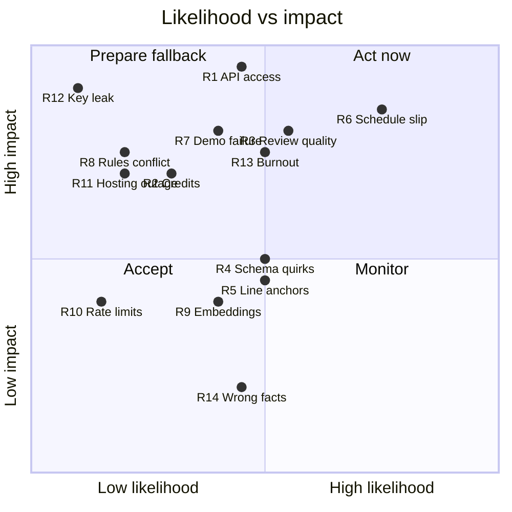

# RISKS.md — Risk Register

The single biggest risk is **API access** (R1): if the Meta Model API key does not work from Malaysia tonight,
nothing else in the plan matters, so it is gate G0. After that, the main risks are schedule slip (R6) and review
quality (R3), both handled by gates, the cut list and the verifier.

## 1. Risk map

Positions are judgement calls made on 27 Oct, not measurements. Revisit them at each gate.

## 2. Register

| ID | Risk | Trigger / early signal | Mitigation | Fallback | Phase |
| --- | --- | --- | --- | --- | --- |
| R1 | Meta Model API unusable from Malaysia, or credits not provisioned (the July preview was US-only) | `winnow smoke` fails with an access or region error | Run G0 tonight; ask in Discord office hours on 27–28 Oct | All LLM calls go through `LLMClient`; switch to a Meta open-weights model served via partner credits (Baseten, Modal, Fireworks) while access is resolved | F0 |
| R2 | Credits run out | `spend_daily` above plan two days running | Prompt caching, per-run token budget, daily cap, contributor model for public-repo evals only | Fewer specialists; shorter context packs; ask organisers | All |
| R3 | Review quality from Muse Spark below expectations (third-party reports place it behind some competitors on coding benchmarks) | Eval recall < 50% or precision < 60% on F2–F3 | High effort for security and verifier; evidence-or-silence; narrow specialist prompts; tune on failures | Present precision and the verifier's lift as the story; fewer, better comments | F2–F6 |
| R4 | Structured output or tool-calling quirks | Schema rejections or malformed tool calls in the smoke test | Discover in F0; one repair retry; Pydantic validation on every output | JSON mode without strict schema + validation | F0–F3 |
| R5 | Comments anchored on the wrong lines (GitHub 422) | Any 422 in logs | Deterministic line checks in the verifier; diff fixtures in unit tests | Post findings in the summary comment | F2–F4 |
| R6 | Schedule slip / scope creep | A gate fails at the end of its day | Gates, cut list, feature freeze 2 Nov 20:00 | Apply the cut list in order ([PLAN.md §9](../PLAN.md)) | All |
| R7 | Demo fails during recording | API error or timeout mid-take | Three rehearsals; manual QA list; segments recorded separately | The golden run recorded on F7 | F7–F8 |
| R8 | Official Rules conflict with the plan (existing code, repo, video format) | Reading the rules in F0 | Fresh repo started 27 Oct; nothing copied from the earlier PDF-RAG project | Adjust the submission format; record any change in PLAN §2 | F0 |
| R9 | Embedding model too slow or too large on Fly | Indexing the demo repo takes > 2 min, or memory errors | Bake the model into the image; 2 GB machine; batch embedding | `all-MiniLM-L6-v2`, or graph + FTS only (retrieval still works) | F1, F5 |
| R10 | Rate limits during the demo | 429s in `agent_steps` | Standard tier is 3,000 RPM; semaphore of 4; backoff | Two specialists instead of four | F5–F8 |
| R11 | Hosting down during judging | Health check alerts | `auto_stop_machines = "off"`, min 1 machine, uptime monitor | Video + screenshots carry the evaluation; restart and redeliver webhooks | 4–10 Nov |
| R12 | Secret leak (App key, API key) | gitleaks alert, unexpected API spend | Secrets handling in [SECURITY.md §6](../SECURITY.md); gitleaks pre-commit and CI | Rotate immediately; revoke the App key; redeploy | All |
| R13 | Personal availability or burnout | Two days below the planned hours | Realistic hours (PLAN Q6); a buffer night before the deadline | Cut list; shorter video | All |
| R14 | Third-party facts wrong (judging weights, credits, team size) | Official Rules differ | The plan relies on official sources where it matters | Update PLAN §2; most tasks are unaffected | F0 |
| R15 | Naming conflicts with Meta trademarks | — | No "Muse" or "Meta" in the product name; say "built with Muse Spark" instead | Rename before F7 | F7 |
